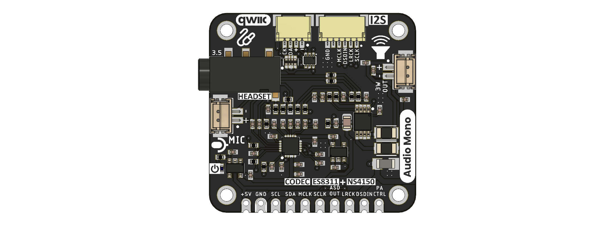

# UNIT I2S ES8311 Codec with Amplifier Module

The UE0097 module provides mono audio recording and playback for an external
controller. It combines an ES8311 audio codec, an NS4150B speaker amplifier,
an analog microphone input, a 3.5 mm audio jack, a two-pin speaker output,
I2S/PCM audio signals, and I2C control.

## Applications

| Application | Module path |
|---|---|
| Microphone capture | Analog microphone connector to ES8311 ADC and ASDOUT |
| Speaker playback | Host DSDIN1 to ES8311 DAC and NS4150B amplifier |
| 3.5 mm audio playback | Host DSDIN1 to ES8311 DAC and jack circuit |
| Bidirectional voice | Simultaneous record and playback paths |

These paths describe connections in the supplied schematic. Application-level
performance has not been characterized.

## Product Reference

The [Product Reference source](tools/product-reference/README.md) preserves the
existing chapter structure and leaves unsupported specification values empty.
The publication workflow builds the PDF and DOCX and lists them on the
[hardware downloads page](docs/hardware/index.html).

## Hardware sources

- [UE0097 revision 2.0 schematic](hardware/resources/unit_sch_v_2_0_0_i2s_es8311_codec_with_amplifier_module.pdf)
- [ES8311 User Guide](hardware/resources/es8311_user_guide.pdf)
- [Top and bottom board views](hardware/assets/README.md)
- [Hardware overview](hardware/README.md)

The board images are labelled V1.1.0, while the available schematic is
revision 2.0. Verify the physical board revision before relying on connector
orientation or assembly options.

## License

The repository's original material is covered by [LICENSE](LICENSE).
Third-party documents, including the ES8311 User Guide, retain their own
terms.
