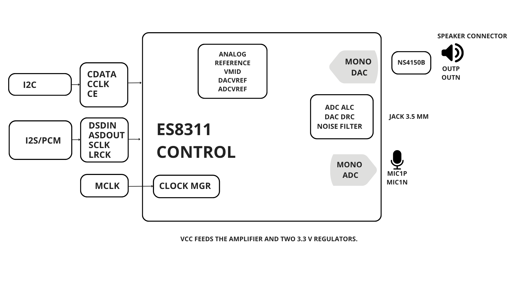
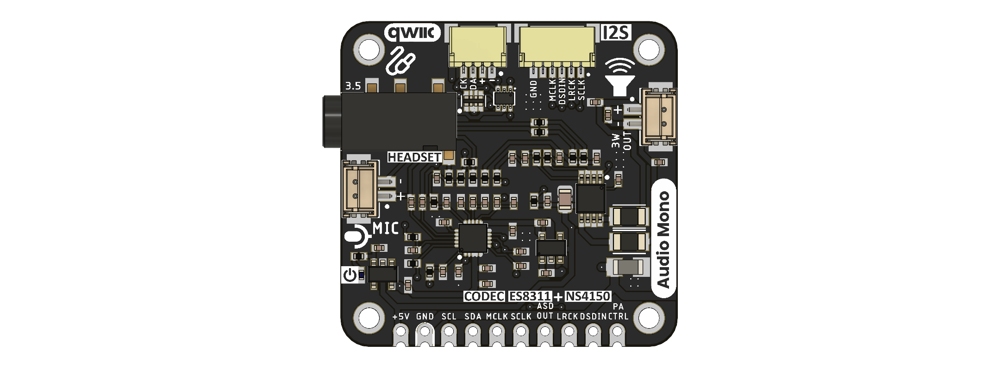
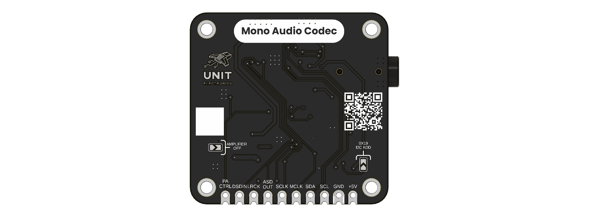
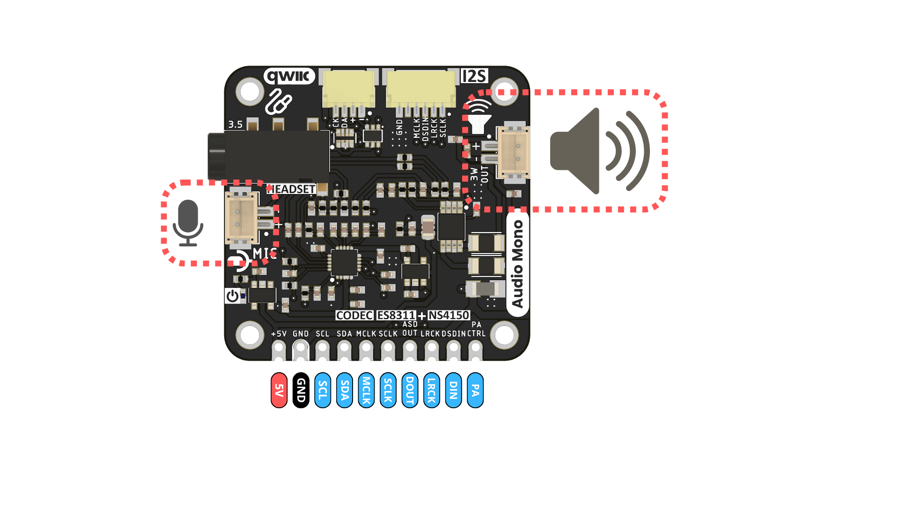

# DevLab I2S ES8311 Codec with Amplifier Module Hardware

## Hardware Scope

This page summarizes the supplied schematic revision 2.0. Board images
are tagged V1.1.0 and have not been reconciled with that schematic. Use the
[Product Reference](../tools/product-reference/README.md) for the full chapter
structure, source distinctions, and blank fields for undocumented values.

| Field | Value |
|---|---|
| MPN | UE0097 |

## Power Tree

The supplied schematic identifies `U1` and `U2` as 3.3 V supplies for the digital and analog codec sections. Validated VCC limits, rail current, and power-path behavior remain unspecified; a separate power-tree drawing is not available.

## Block Diagram

## Naming Rules

- Product name: **DevLab I2S ES8311 Codec with Amplifier Module**.
- Product family: **UNIT DevLab ecosystem**.
- Existing source files retain their published names and revisions.
- Generated Product Reference: `unit_product_reference_v_0_1_0_i2s_es8311_codec_with_amplifier_module.pdf`.

## Hardware

| Reference | Part | Function |
|---|---|---|
| IC1 | ES8311 | Mono audio codec and I2S/PCM interface |
| IC2 | NS4150B | Differential speaker amplifier |
| U1, U2 | AP2112K-3.3V | Digital and analog 3.3 V supplies |
| J1 | Two-position connector | Differential speaker output |
| J2 | Two-position connector | Analog microphone circuit |
| J3 | PJ-320D | 3.5 mm audio jack |
| J4 | 10-position castellated header | Power, control, and digital audio |
| J6 | Four-position connector | Power, ground, SDA, and SCL |

### Board Views

[Schematic revision 2.0](resources/unit_sch_v_2_0_0_i2s_es8311_codec_with_amplifier_module.pdf)

## Pinout

| Pin | Signal | Function |
|---:|---|---|
| 1 | VCC | Module supply, marked +5V on board image |
| 2 | GND | Ground |
| 3 | SCL | I2C clock |
| 4 | SDA | I2C data |
| 5 | MCLK | Master-clock input |
| 6 | SCLK | Serial audio bit clock |
| 7 | ASDOUT | ADC serial audio output |
| 8 | LRCK | Serial audio frame clock |
| 9 | DSDIN1 | DAC serial audio input |
| 10 | PA_CTRL | Amplifier control |

The ES8311 CE pin is pulled high on the supplied schematic, corresponding to
the 7-bit I2C address 0x19 in the ES8311 User Guide. The J6 connector labelled
QWIIC carries VCC, not the regulated 3V3 net. Confirm the attached device's
power and logic requirements before connecting it.

## Dimensions

Validated board dimensions are not supplied in the available product-specific documents.

## Topology

The ES8311 codec connects to the host through J4 and drives the NS4150B speaker amplifier. The supplied schematic also shows a microphone input and a 3.5 mm audio jack. See the [Block Diagram](#block-diagram) for the functional paths.

## Pin & Connector Layout

- **J1:** two-position differential speaker output.
- **J2:** two-position analog microphone connection.
- **J3:** 3.5 mm audio jack.
- **J4:** 10-position host castellated header; see the [Pinout](#pinout) table.
- **J6:** four-position connector for power, ground, SDA, and SCL. Its VCC contact is not the regulated 3V3 net.

## Functional Description

The ES8311 provides I2S/PCM audio conversion for the microphone and playback paths. The NS4150B drives the differential speaker output. The supplied schematic shows the ES8311 CE pin pulled high, corresponding to 7-bit I2C address `0x19` in the ES8311 User Guide. Validate the connected host and peripherals against the J4 and J6 power and logic levels before use.

## Applications

| Application | Module path |
|---|---|
| Microphone capture | Analog microphone connector to ES8311 ADC and ASDOUT |
| Speaker playback | Host DSDIN1 to ES8311 DAC and NS4150B amplifier |
| 3.5 mm audio playback | Host DSDIN1 to ES8311 DAC and jack circuit |
| Bidirectional voice | Simultaneous record and playback paths |

These paths describe connections in the supplied schematic. Application-level
performance has not been characterized.

## References

- [Revision 2.0 schematic](resources/unit_sch_v_2_0_0_i2s_es8311_codec_with_amplifier_module.pdf)
- [ES8311 User Guide](resources/es8311_user_guide.pdf)
- [Top view](img/unit_top_v_1_1_0_i2s_es8311_codec_with_amplifier_module.png)
- [Bottom view](img/unit_bottom_v_1_1_0_i2s_es8311_codec_with_amplifier_module.png)
- [Functional block diagram](img/unit_block_diagram_v_0_1_0_i2s_es8311_codec_with_amplifier_module.png)
- [J4 host header pinout](pinout/unit_j4_header_pinout_v_0_1_0_i2s_es8311_codec_with_amplifier_module.png)

Validated VCC limits, speaker load, output power, current consumption, and
mechanical dimensions are not supplied in the available board documents.

- [Product Reference](../docs/hardware/unit_product_reference_v_0_1_0_i2s_es8311_codec_with_amplifier_module.pdf)
